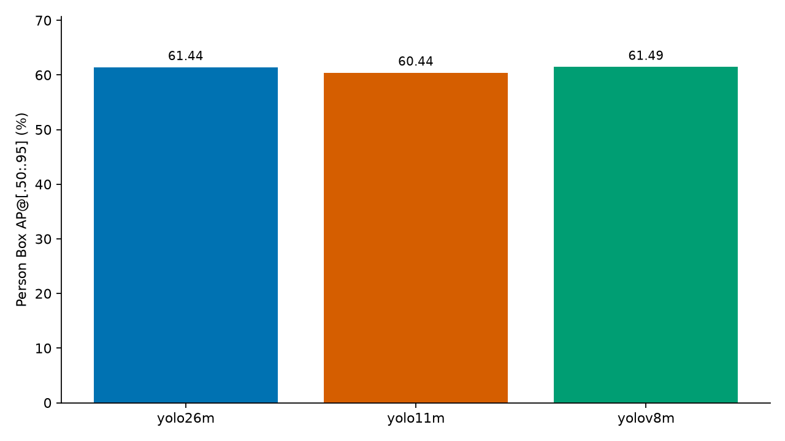

# Medium (M) YOLO Segmentation Benchmark — CCTV600

## ภาพรวม

ประเมิน pretrained segmentation checkpoints กลุ่ม Medium (M) บน CCTV Human Parsing 600 ด้วยคะแนนกรอบบุคคล ทุกรุ่นใช้ input 640, FP32, batch 1 และ population เดียวกันบน Tesla T4

## สถานะ

**COMPLETE** คุณภาพครบ 3/3 โมเดล ตัวละ 600 ภาพ เวลาครบ 3 clean rounds ต่อโมเดล อ่านแหล่งผลและประวัติ timing continuation จาก [สถานะรวม](https://github.com/folklazy/YOLO_Instance_Segmentation_CCTV600_Scaling_Study/blob/main/metrics/CLOSEOUT.json)

## ผลหลัก

| Model | Box AP % | AP75 % | Recall % | Forward ms/ภาพ | Adapter ms/ภาพ | FPS | Allocated MiB |
| --- | --- | --- | --- | --- | --- | --- | --- |
| yolo26m-seg.pt | 61.437 | 69.662 | 74.252 | 29.719 | 56.126 | 17.817 | 605.934 |
| yolo11m-seg.pt | 60.436 | 67.273 | 73.212 | 30.418 | 61.257 | 16.325 | 696.762 |
| yolov8m-seg.pt | 61.489 | 69.790 | 75.423 | 30.927 | 69.127 | 14.466 | 766.317 |

Box AP/P/R/F1 แสดงเป็นเปอร์เซ็นต์ Forward และ adapter เป็น ms/ภาพ, FPS = 1000 / mean adapter ms และ VRAM เป็น peak allocated MiB

## รายงาน

| เอกสาร | เนื้อหา |
| --- | --- |
| [RESULTS_SUMMARY_TH.md](RESULTS_SUMMARY_TH.md) | คะแนน ผู้ชนะรายด้าน บทบาทและข้อแลกเปลี่ยนของแต่ละโมเดล |
| [PRESENTATION_SUMMARY_TH.md](PRESENTATION_SUMMARY_TH.md) | กราฟและหลักฐานข้อผิดพลาดจาก fixed sample เดิม |
| [REPORT.md](REPORT.md) | Models, compatibility, ผลเต็ม, timing, source และข้อจำกัด |
| [EXPERIMENT_PROTOCOL.md](EXPERIMENT_PROTOCOL.md) | เงื่อนไขที่ใช้รัน |

## ภาพรวมคุณภาพ



## การนำทางทั้ง study

[Largest (X/E)](https://github.com/folklazy/YOLO_Large_Seg_CCTV600_Benchmark) · [Second-largest (L/C)](https://github.com/folklazy/YOLO_Second_Largest_Seg_CCTV600_Benchmark) · [Medium (M)](https://github.com/folklazy/YOLO_Medium_Seg_CCTV600_Benchmark) · [Small (S)](https://github.com/folklazy/YOLO_Small_Seg_CCTV600_Benchmark) · [Nano (N)](https://github.com/folklazy/YOLO_Nano_Seg_CCTV600_Benchmark) · [Master](https://github.com/folklazy/YOLO_Instance_Segmentation_CCTV600_Scaling_Study)

## ตรวจย้อนกลับ

[ผลและ timings](metrics/) · [Config](configs/benchmark.json) · [Bindings](https://github.com/folklazy/YOLO_Instance_Segmentation_CCTV600_Scaling_Study/blob/main/metrics/RESULT_INDEX.json) · [คู่มือตัวชี้วัด](https://github.com/folklazy/YOLO_Instance_Segmentation_CCTV600_Scaling_Study/blob/main/METRIC_GUIDE_TH.md)

ภาพ CCTV และ per-frame records เก็บ private ชุดหลักฐานภาพของรอบตรวจเอกสารอยู่ใน Master ที่ `outputs/presentation-20261116T094620918214Z/cases/medium/index.html` ใช้คู่กับรายงานภาพ โดยเก็บภาพเต็มและ ROI พิกัดเดียวกันครบทุกโมเดล

คำสั่งจาก workspace สำหรับตรวจสถานะปิดรอบ

```bash
.venv/bin/python YOLO_Instance_Segmentation_CCTV600_Scaling_Study/analysis/closeout.py --status
```
